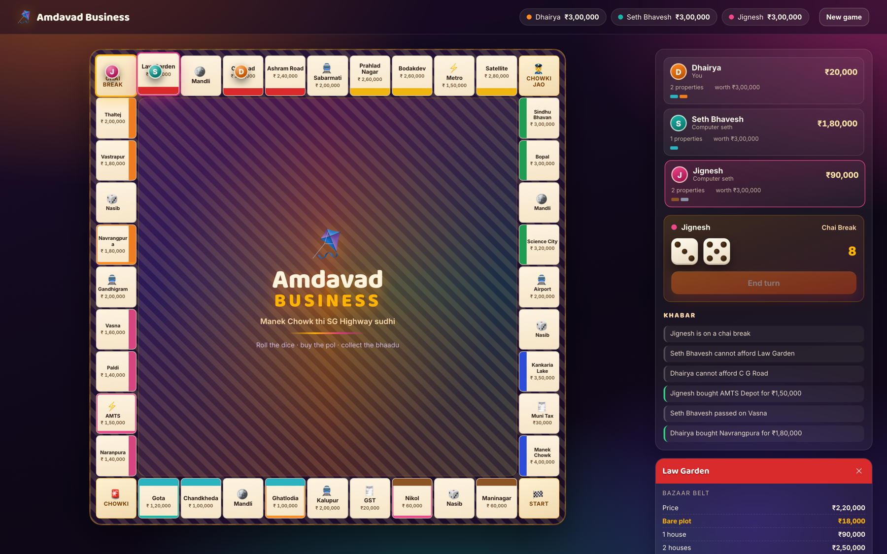
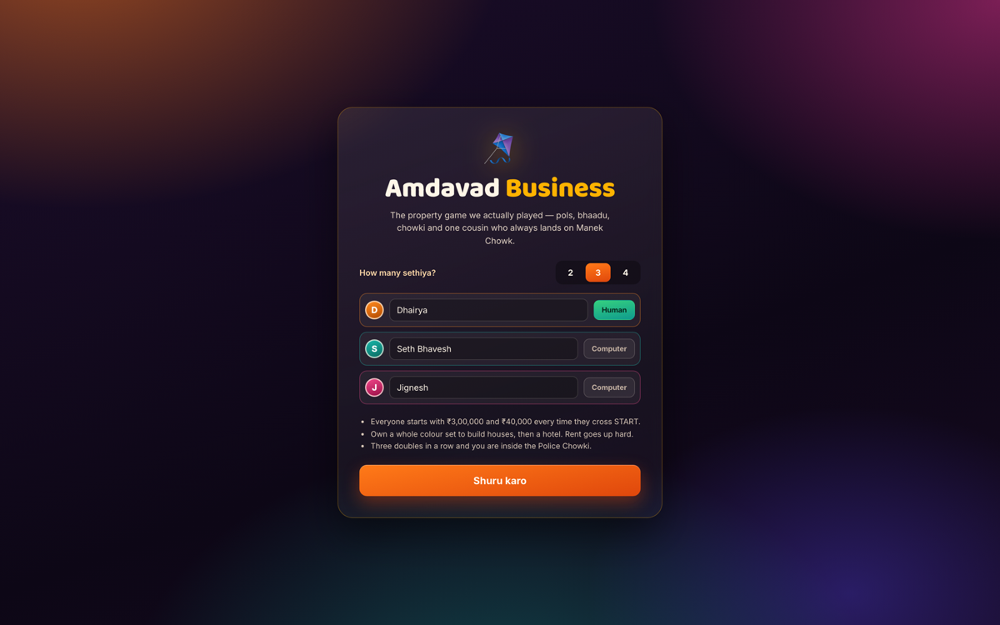

# 🪁 Amdavad Business

A desi Ahmedabad take on the property-trading board game we all grew up playing
on a folded cardboard sheet — except the board is Maninagar to Manek Chowk, the
rent is *bhaadu*, jail is the **Police Chowki**, and Free Parking is a **chai break**.

Frontend only. React + Vite, no backend, no API keys, no install beyond `npm i`.

  



## Play

```bash
npm install
npm run dev
```

Pick 2–4 sethiya, mark who is human and who is a computer seth, and roll.

## What's in it

- **A full 40-tile Amdavad board** — 22 properties in 8 colour sets (Juna Amdavad,
  Paschim Pol, Bazaar Belt, SG Corridor…), 4 stations (Kalupur, Gandhigram,
  Sabarmati, SVP Airport) and 2 utilities (AMTS Depot, Metro Rail).
- **Proper rules, not a toy**: double rent on a complete colour set, even-build
  rules for houses and hotels, mortgages, three-doubles-and-you-are-inside,
  the exact-rent station ladder and dice-multiplier utilities.
- **Nasib & Mandli Fund cards** — 24 cards written for the city: Uttarayan kite
  cuts, BRTS lane fines, Navratri pass resale, Torrent bills, a lawyer cousin who
  hands you a Chowki-mafi card.
- **Computer sethiya** that buy to complete sets, keep a cash reserve, and build
  houses the moment they can afford to.
- **Tokens that hop square by square** instead of teleporting, so you can watch
  your opponent walk straight into your hotel.
- Tap any square to read its full rent card, who owns it and what it costs right now.
- Money printed the way it is spoken: `₹45,16,000`, not `₹4,516,000`.

## How it is built

```
src/
  data/board.js      the 40 tiles, card decks, colour sets, grid geometry
  game/engine.js     pure reducer: dice, movement, rent, building, bankruptcy
  game/ai.js         the computer seth's decision function
  components/        Board, Panel (players + dice + log), Holdings, Setup
```

The whole game is one pure `reducer(state, action)`. Nothing in the UI knows the
rules, which is why the engine can be simulated head-less — 40 four-player
games were run end to end to catch dead-ends before any of this was styled.

## Rules summary

| | |
|---|---|
| Starting cash | ₹3,00,000 |
| Crossing START | ₹40,000 |
| Chowki fine | ₹20,000 |
| Houses | own the full colour set, build evenly, 4 houses then a hotel |
| Mortgage | half the price, no rent until cleared (55% to clear) |
| Winning | last seth standing |

## Screens



## License

MIT
